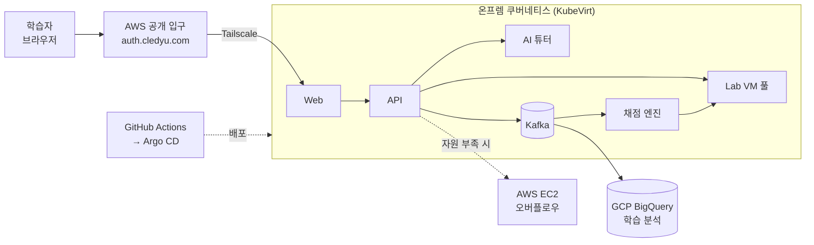
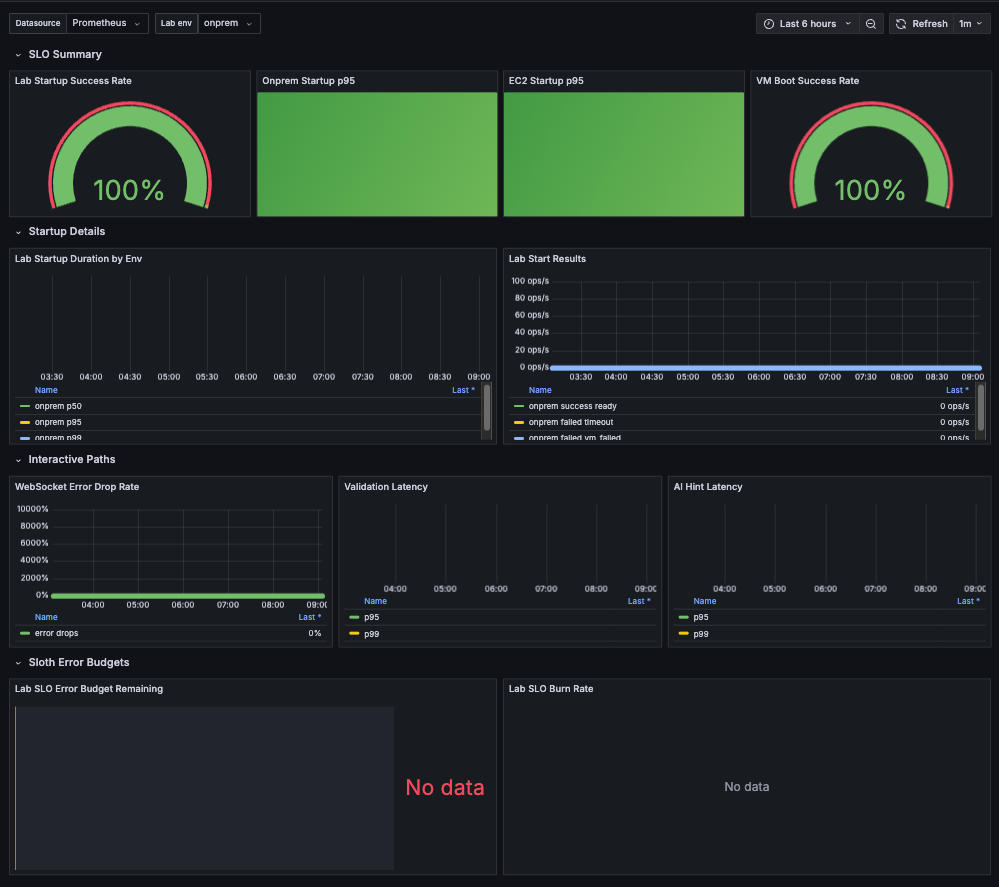
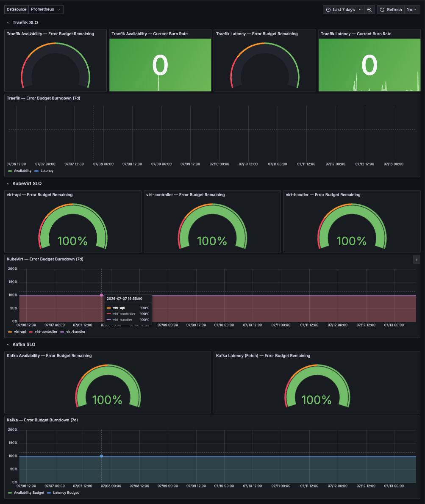
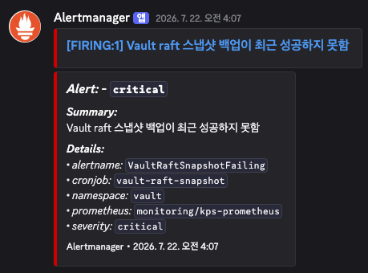
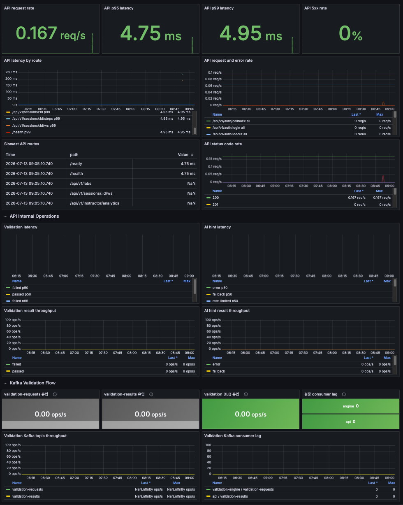

# Cledyu

> 브라우저만으로 격리된 VM에서 Linux · Docker · Kubernetes · Ansible · Terraform을 실습하는
> **멀티테넌트 Hands-on 교육 플랫폼**.
> AI 학습 도우미가 힌트를 주고, 자동 채점 엔진이 실습 결과를 검증합니다.

KT Cloud Tech-Up 교육생을 1차 타겟으로 만들었습니다. 학습자는 웹에서 Lab을 고르면 자신만의 VM을 받고,
막히면 AI 힌트를 요청하고, 단계를 마칠 때마다 자동 채점을 받습니다.

## 왜 만들었나

- 외부 교육 플랫폼 라이선스 없이 자체 인프라에서 실습 환경을 운영하기 위해
- 강사 1명이 여러 학습자를 보는 구조의 병목을 AI 힌트와 자동 채점으로 줄이기 위해
- 실습 진행·막힘 데이터를 쌓아 Lab 개선에 쓰기 위해

## 주요 기능

- **격리된 Lab VM**: 온프렘 KubeVirt 풀을 우선 사용하고, 자원이 부족하면 AWS EC2로 오버플로우
- **AI 학습 도우미**: 정답 대신 단계별 힌트를 주는 튜터 (Gemini + RAG, 정답 누출 필터 · 호출 제한)
- **자동 채점**: Lab 완료 조건을 YAML로 정의하고, 채점 엔진이 VM에 접속해 검증
- **다양한 Lab**: Linux, Docker, Kubernetes, Helm, Ansible, Terraform
- **학습 분석**: 실습 이벤트를 Kafka → Airflow → BigQuery로 적재
- **관측성**: SLI/SLO 기반 대시보드와 Discord 알림
- **장애 대응**: AWS EKS 기반 DR (장애 감지 → Discord 승인 → 페일오버/페일백)

## 아키텍처



전체 구성도(인증, 데이터, 관측성 포함)는 [`docs/architecture`](docs/architecture)를 참고하세요.

## 기술 스택

| 영역 | 기술 |
|---|---|
| 클러스터 | kubeadm HA + kube-vip (KVM 3노드), Cilium, MetalLB, Longhorn |
| Lab VM | KubeVirt + CDI, AWS EC2 오버플로우, Packer 이미지 빌드 |
| 서비스 | Next.js (web), Go (api, validation-engine), Python FastAPI (ai-tutor) |
| 데이터 | PostgreSQL (CloudNativePG), Redis, Kafka (Strimzi), ChromaDB, Airflow, BigQuery |
| 인증 · 보안 | Keycloak (네이버 로그인), Vault, External Secrets, cert-manager, Kyverno |
| 네트워크 | Traefik, Tailscale, AWS ALB (공개 입구) |
| GitOps · CI | Argo CD (App-of-Apps), GitHub Actions |
| 관측성 | Prometheus, Grafana, Loki, Tempo, Alloy, Sloth, Alertmanager |
| 신뢰성 | Velero, AWS EKS 기반 DR |

## 빠른 시작 (온프레미스 호스트)

**사전 요구사항**: Ubuntu 22.04, 32C/128GB 이상 (nested virtualization 권장), SSH 접근, sudo 권한

```bash
# 1) 호스트에 libvirt 설치 + NAT 네트워크 생성
make host-prep HOST=<호스트-IP>

# 2) Terraform으로 VM 3대 프로비저닝 (libvirt provider)
make kvm-apply

# 3) kubeadm HA 클러스터 부트스트랩
make k8s-bootstrap

# 4) Cilium, MetalLB, Longhorn 설치
make platform-up

# 5) Tailscale subnet router 설치
make tailscale-up AUTHKEY=tskey-auth-...

# 6) Argo CD 설치 + 루트 App-of-Apps 동기화
make argocd-up

# 7) [확인 필요] cert-manager, Keycloak, 로컬 DNS, 클라이언트 신뢰, API 서버 OIDC
#    ansible/playbooks/31, 70, 80, 81, 82 단계에 해당하는 make 타겟 또는 ansible-playbook 명령
```

- **확인**: `kubectl get nodes`로 노드 3대가 Ready인지, Argo CD에서 앱이 Synced인지 확인합니다.
- 단계별 설명은 [`docs/architecture/phases.md`](docs/architecture/phases.md), 네트워크 설계는 [`docs/architecture/network.md`](docs/architecture/network.md)를 참고하세요.

## 관측성

Lab 시작 지연, VM 부팅 성공률 같은 지표를 SLI로 정의하고 Sloth로 SLO를 관리합니다.
번다운 대시보드와 Alertmanager → Discord 알림, Tempo 트레이싱으로 문제를 추적합니다.

| Lab SLO 대시보드 | SLO 번다운 |
|---|---|
|  |  |

| Alertmanager | API · 채점 트레이싱 (Tempo) |
|---|---|
|  |  |

장애 조사 절차는 [`docs/RUNBOOK/slo-investigation.md`](docs/RUNBOOK/slo-investigation.md)에 있습니다.

## 디렉토리 구조

```
.github/              CI 워크플로우
ansible/              호스트·클러스터 부트스트랩 (playbooks, roles)
apps/
  web/                Next.js 프론트엔드 (Lab 카탈로그, 터미널, AI 튜터 패널)
  api/                Go API (세션, 인증, VM 오케스트레이션, Lab 콘텐츠)
  validation-engine/  Go 채점 엔진 (Kafka 소비)
  ai-tutor/           Python AI 힌트 서비스 (Gemini + RAG)
  airflow/            lab-events → BigQuery 적재 DAG
assets/               README용 스크린샷
docs/                 ADR, 아키텍처, 런북, 설계 스펙
gitops/
  apps/               서비스·플랫폼 Helm 차트와 매니페스트
  argocd/             Argo CD Application (apps: 온프렘, apps-eks: DR)
infra/
  terraform/          aws, gcp, kvm, keycloak
  kubernetes/         클러스터 공통 매니페스트
  images/lab-base/    Lab VM 이미지 빌드 (Packer)
  vault/              Vault 정책
  keycloak-theme/     로그인 화면 테마
keycloak/naver-idp/   네이버 로그인용 Keycloak SPI (Java)
scripts/              루트 CA 신뢰 설치, Vault 설정 스크립트
Makefile              실행 진입점
```

## 문서

- [아키텍처](docs/architecture): 단계별 로드맵, 네트워크 설계, Lab DSL, AI 튜터, pivot 배경
- [ADR](docs/ADR): 주요 설계 결정 기록
- [런북](docs/RUNBOOK/README.md): 운영·장애 대응·DR 절차
- [설계 스펙과 계획](docs/superpowers): 기능별 설계 문서

## 팀

5인 팀 프로젝트 (2026.04 ~ 2026.07)

| 이름 | 역할 | 담당 |
|---|---|---|
| 김용균 | 팀장 / 플랫폼 아키텍트 | kubeadm HA, KubeVirt/EC2 오케스트레이터, CI/CD, DR |
| 윤승호 | DevSecOps / AI 튜터 | VM 격리, Keycloak · Vault · Falco, AI 학습 도우미(ai-tutor) |
| 조승연 | SRE / 관측성 | SLI·SLO 정의, Prometheus · Grafana · Loki, 카오스 엔지니어링 |
| 김찬영 | Lab 콘텐츠 / 채점 엔진 | Lab YAML DSL, 채점 엔진, 학습 분석 파이프라인 |
| 한정현 | 풀스택 | Next.js 프론트, Go 백엔드 API, 강사 모드 |

## 기여

개발 규칙과 커밋 컨벤션은 [CONTRIBUTING.md](CONTRIBUTING.md), 보안 이슈는 [SECURITY.md](SECURITY.md)를 참고하세요.
